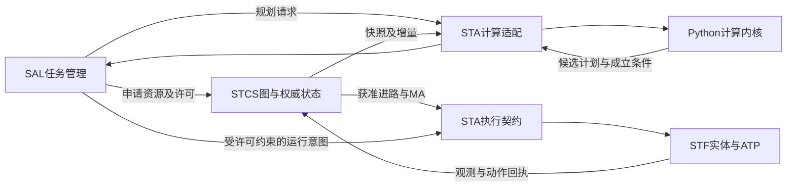
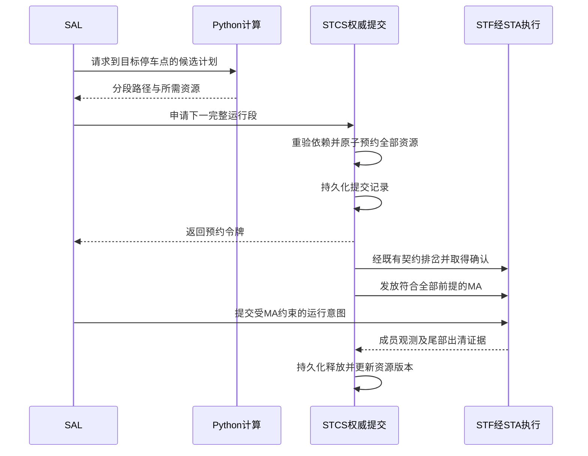

# SkyRail行车规则与计算守护进程设计草案

状态：设计草案 D0，2026-11-20。本文规定拟新增契约，不代表当前插件已经实现这些能力。

当前运行基线为 STA 2.5.0、STF 5.0.0、STCS 4.3.2、SAL 0.3.0、PCC 2.2.3。拟新增能力包括上下行约束、单线站间整体预约、途中多次折返寻路，以及独立Python计算进程。现有图、MA和驾驶权接口继续遵守各自的版本与有效性要求。

管理员维护工务线路、里程和停车设施；系统据此规划到目标停车点的合法运行方案，无须针对每一种配线编写调车脚本。可达性必须同时考虑运行方向、整列长度、可停车空间、道岔出清及资源冲突。一个候选方案不构成行车许可。

## 1 共同边界与术语

### 1.1 职责和唯一写入者

| 组件 | 保留的职责 | 本次拆分后的边界 |
| --- | --- | --- |
| STCS插件 | 工务设备观测、RailGraph局部更新、权威占用、预约事务、MA与排路仲裁 | 发布不可变快照；统一提交资源预约和许可 |
| SAL插件 | 叫车、任务生命周期、站停、人工移交、运行计划推进 | 请求计算，逐段执行已获准的计划，处理真实动作回执 |
| STF | 列车实体、完整性观测、驾驶权、牵引制动、ATP、道岔执行 | 经STA接收意图，在实体或区域所属线程执行 |
| STA | 版本化契约、来源身份、请求与回执、计算进程适配 | 让插件与计算进程交换数据，不代替STCS裁决 |
| Python守护进程 | 方向规则编译、控制区间分析、通用寻路、资源需求计算 | 持有快照和计算缓存，返回候选结果 |
| PCC | 显示计划、预约、故障、阻塞原因和人工恢复入口 | 显示STCS确认后的状态，操作沿既有授权链提交 |

第一阶段由STCS保持占用、资源预约和MA的唯一提交权。Python中的占用与预约数据只是只读投影，不能与Java各自维护一份可写台账。以后若迁移提交权，需要单独设计权威交接，不能依赖本草案默认发生。

### 1.2 三种不同对象

- **物理连接**：RailGraph中的轨道、节点、端口及允许的道岔通过关系。道岔当前开向不改变物理拓扑是否存在。
- **工务线路**：轨道边的线路归属、里程基准与上下行规则，例如 `main:up`。
- **运营线路**：SAL的任务名称、停站顺序与目的地，例如 `Line1`。它不能覆盖工务线路的方向限制。

**等待区 HoldingArea** 是可以让整列车停稳、出清相关咽喉并等待下一步许可的物理轨道范围。一个SAL station、应答器或线路名称本身不证明具备这种容量。

**控制区间 ControlSection** 是两个等待区之间需要统一控制的运行资源。它可以跨多个应答器和多条图边。

**运行计划 MovementPlan** 包含一个或多个有方向的运行段及停稳换向动作。资源预约、道岔确认、MA和实际执行回执分别成立。

### 1.3 单位与一致性

计算契约统一使用米、米每秒和秒。Minecraft坐标保留世界标识及方块坐标，换算只依据快照中的 `blocksPerMeter`；比例变化使相关结果失效。

共享身份包括列车UUID、编组版本、任务UUID、驾驶权租约、服务会话及STCS控制代际。司机释放驾驶权、MA失效、列车从在线列表消失，都不能证明车身资源已出清。

使用已知但卸载的拓扑时，沿用[增量RailGraph契约](RAILGRAPH-INCREMENTAL.md)。保留连接不证明占用空闲、道岔已确认或车辆观测新鲜。

## 2 契约一 上下行方向规则

### 2.1 名称和里程解释

解析工务线路名称的最后一个冒号。后缀去除首尾空白后按不区分大小写比较；基名和显示名称仍保留既有线路标识语义。

| 已确认的工务线路名称 | 正常运行方向 |
| --- | --- |
| `<基名>:up` | 里程递减 |
| `<基名>:down` | 里程递增 |
| 非up/down后缀，或没有后缀 | 双向单线，需要控制区间预约 |

例如 `main:branch:up` 的基名是 `main:branch`，后缀是 `up`。有效名称但后缀未知，按用户定义的单线规则处理；空名称、未确认归属或冲突归属不属于这一情况。

对一条有向边，令 `Δm = toMileage − fromMileage`。两端必须属于同一个已确认工务线路和里程基准，且里程差与该边几何长度一致。

- up边：`Δm < −epsilon_m` 时正常方向合法。
- down边：`Δm > epsilon_m` 时正常方向合法。
- 差值接近零、缺少里程、基准冲突或几何校验失败：方向未知。

`epsilon_m` 的草案默认值为0.01米，其变更属于规则版本变更。不同线路、不同里程原点或里程重置两侧，不能直接相减。

### 2.2 编译结果

STCS根据已确认RailGraph和里程归属发布方向规则；Python可负责纯计算，但结果须经STCS确认后成为规则快照。SAL与STCS使用同一规则版本，不能各自猜测。

| 字段 | 含义 |
| --- | --- |
| `edgeId` | 有向图边标识 |
| `lineId`、`lineBase`、`suffix` | 工务归属及后缀解析结果 |
| `mileageReferenceId` | 可比较的里程基准 |
| `fromMileageM`、`toMileageM` | 同一基准下的端点里程 |
| `trafficClass` | UP、DOWN、SINGLE、CONNECTOR或UNKNOWN |
| `normalAllowed` | 正常自动运行能否沿该有向边行驶 |
| `reason` | 禁行或未知原因 |
| `ruleVersion`、`dependencies` | 规则版本及图边、标定、连接规则依赖 |

跨线连接、渡线和站场咽喉使用CONNECTOR规则，按已确认端口组合连接合法的入口和出口；接入正线时仍检查目标有向边的上下行规则，不能通过连接边绕过逆向限制。未归属的空白边不能自动获得CONNECTOR或双向通行资格。无法确认连接规则时返回UNKNOWN。

### 2.3 放行约束

正常自动运行中，up/down方向是硬约束，不能仅用较高寻路代价表示逆向。线路被占用时，系统可以等待或选择其他合法路径，不能自行逆行绕过拥塞。

特殊逆向授权需明确列车、边集合、允许方向、操作范围和有效期，并由STCS裁决。D0不新增自动申请此类授权的能力；未提供有效例外时拒绝逆向。SR监督模式本身不等于逆向运营授权。

同基名的up/down名称用于表达标定意图，不足以从几何上证明“靠左”。PCC应显示编译后的方向箭头、里程变化和未知原因，供管理员检查。系统不通过两条线在屏幕上的上下位置推定运行方向，也不假定两条线具有同一个里程原点。

### 2.4 更新与异常

方向规则随相关里程、线路归属和拓扑依赖变化而重编译。无关设备变化不使其他路径的方向规则失效。

发现前方规则未知或变化时，停止基于旧规则申请新的准入与延长计划。已发MA仍按现有有效性及ATP规则处理，必要时在受影响区域前停车；不能通过改写旧MA的版本使其继续有效。

## 3 契约二 单线站间预约

### 3.1 控制区间边界

没有up/down后缀的已确认线路，按双向单线建立控制区间。区间不是“相邻应答器之间的一条边”，而是连接可安全等待地点的一组物理资源。

等待区定义至少包括：沿轨可用范围、可用长度、允许停车方向、与咽喉的净空关系、进入和退出端口、停车禁区以及依赖版本。容量沿实际轨道测量，不能用两端直线距离代替。

站台标可以引用等待区，但不能仅凭标志存在自动获得接车资格。系统可分析站场和会让线来辅助生成等待区；无法证明整列可容纳时，需要补充设施定义或合并到下一个可等待地点。没有有效边界时返回 `HOLDING_AREA_UNDEFINED`，不把任意应答器作为停车边界。

| 对象 | 核心内容 |
| --- | --- |
| HoldingArea | 稳定ID、轨道范围、可用容量、入口/出口、停车限制、版本 |
| ControlSection | 稳定ID、A/B边界、所含物理资源、冲突关系、方向定义、版本 |
| ReservationRequest | 请求ID、列车/编组/任务、入口和出口、目标等待区、整列长度、所需资源、前提版本 |
| ReservationToken | 事务ID、列车身份、控制代际、资源集合、状态、版本、是否可能已准入 |

A→B与B→A必须竞争同一物理控制资源。反向图边、交叉和重叠几何不能因为边ID不同而绕过冲突关系。

### 3.2 第一版准入策略

第一版采用一列车独占一个单线控制区间。即使方向相同，第二列也需等待。后续同向追踪属于另一次契约扩展，不能仅改变一个寻路权重就启用。

进入前，STCS须一次取得以下资源组成的事务：

1. 到下一个有效等待区的单线控制资源。
2. 路径所需的咽喉、道岔和交叉冲突资源。
3. 目标等待区中足以容纳整列和余量的接车范围。

中间地点不能容纳整列时，合并申请至后续有效等待区。事务必须全部成功或全部失败，不能保留一半新增资源再等待另一半。

整段控制预约不要求一次发放覆盖整个站间的MA。MA仍可按现有上限和滚动窗口分段发放，但未取得区间准入资格时，MA不能越过该区间入口。

### 3.3 提交与执行顺序

预约资格、道岔排路请求、实际开向确认及MA分别记录。取得预约不意味着道岔已经转换成功，也不构成牵引授权。

### 3.4 状态和释放证据

| 状态 | 含义 | 可释放条件 |
| --- | --- | --- |
| FREE | 无持有者 | 可参加新事务 |
| RESERVED | 已提交资源，尚无进入证据 | 证明尚未进入且准入已撤销，或证明从未发出进入许可 |
| ENTERED | 已观察到进入，或已有可信进入证据 | 同一完整编组全列出清，或既有契约认可的完整删除回执 |
| RELEASING | 正在核对和持久化释放 | 释放成功落盘后才转FREE |
| UNKNOWN_LOCKED | 无法排除仍有列车或未完成准入 | 重新建立证据后由STCS核对；不得仅因超时转FREE |

“未观察到进入”不等于“证明尚未进入”。提交记录必须包含 `entryAuthorityIssued`：STCS在向车辆发布可越过入口的许可之前，先持久化这一事实。许可可能已发布而缺少进入观测时，即使仍记录为RESERVED，也不得按普通超时自动释放。

区间持有身份绑定列车UUID、编组版本和事务，不以司机UUID或某个MA的存续作为出清证明。解除驾驶权、切换SAL任务、MA过期和守护进程失联都不直接释放已进入区间。

单线内折返时，本车继续持有保护，完成合法换向后重新取得对应方向的MA。它必须满足同样的出清和道岔条件，不能在换向间隙把区间交给对向列车。

### 3.5 排队与持久化

冲突请求进入STCS公平队列，使用稳定顺序及等待时间处理饥饿问题。排队不占有一部分新资源；重算不能无故重置排队资历。区间忙返回WAIT，不伪装成拓扑不通。

单一控制区间预约用于防止站间对向互顶；完整运行段的原子资源事务用于避免入口与出口之间的部分占有。若整个站场没有足够空位，本期不承诺单列规划器能自动解决全网多车重排，系统保持等待并在PCC解释阻塞关系。

拟采用STCS本地事务日志与原子快照保存预约。提交与释放记录持久化成功后才对外确认；落盘失败时不发放基于该变更的新许可。日志记录事务ID、资源集合、持有列车、版本、准入标记、释放证据引用和控制代际。

现有占用账本继续保留。新预约日志不取代物理成员观测，也不以计算进程缓存覆盖旧账本。

## 4 契约三 通用折返寻路

### 4.1 输入与搜索状态

目标可以是depot、station或其他有效停车点，不绑定某一种配线。输入包含：

- 已确认拓扑及边依赖、方向规则、控制区间和等待区。
- 列车UUID、编组版本、全列长度、车辆运行约束、当前有向位置及车身占用范围。
- 目标停车范围、允许到达方向、停车余量与任务约束。
- 当前资源投影及明确的例外授权；动态投影只用于评估候选，不能代替提交时的占用检查。

搜索状态至少包含有向边和偏移、运行方向、整列沿轨覆盖范围、所处控制资源及已执行折返次数。同一位置不同方向不是同一状态；不能只用节点ID去重。

车身范围采用沿轨几何和编组观测约束，不能把整列当作一个点，也不能仅用世界坐标中的包围盒判定能否出清道岔。

### 4.2 允许的动作

| 动作 | 必须满足的前提 |
| --- | --- |
| RUN | 连通端口合法、运行方向允许、所需几何已知；提交阶段能取得完整运行段资源 |
| STOP | 轨道范围足够容纳整列，具备制动及停车余量，没有禁止停车或咽喉侵入 |
| REVERSE | 完整停稳，可重新确定领车和有向位置，整列及受影响道岔满足出清规则，换向后的运行方向合法 |
| WAIT | 位于有效等待区，或因故障在既有保护下停车；等待不产生新的通行权 |

单线允许双向，不意味着任意一点都能折返。up/down正线上也不能通过插入REVERSE动作绕过方向规则。

规划器自动提取可折返的停车范围，不要求管理员逐个标注折返点。候选位置来自目标位置、几何和容量边界、道岔净空及整列长度约束。候选应表达可行位置区间，不能只检查设备节点而漏掉节点之间的可用停车位置。

若离散化或搜索预算不能覆盖某种情况，返回搜索受限，不能宣称已经证明无路。

### 4.3 运行计划输出

| 字段 | 含义 |
| --- | --- |
| `planId`、`requestId` | 计划身份及对应请求 |
| `trainId`、`formationRevision`、`taskId` | 适用列车和任务 |
| `sourceState` | 计算使用的有向位置、编组与观测身份 |
| `dependencies` | 拓扑、方向规则、等待区及控制区间依赖 |
| `legs` | 按顺序执行的RUN段、停车目标及REVERSE动作 |
| `resourceBundles` | 每段需原子取得的控制、咽喉、交叉和接车资源 |
| `assumptions` | 每段成立所依赖的长度、停车空间和授权条件 |
| `cost`、`policyVersion` | 路程、折返代价和估计等待等排序依据 |
| `status`、`reason` | FOUND、WAIT、NO_ROUTE、UNKNOWN或LIMIT及原因 |

每个RUN段给出有向边与偏移序列、明确停止位置、允许终到误差、净空要求及之后的动作。速度与制动可行性必须使用当前车辆参数；没有足够停车距离时不能输出可执行折返点。

排序使用非负的路程、折返代价和预计等待成本，权重归入策略版本。合法性先于成本；禁止方向不能通过高成本保留为可选方案。

D0建议初始搜索预算为2秒、100000个展开状态、最多8次折返，均为待回放测量调整的草案参数。达到任一上限返回LIMIT并注明截断条件，不返回NO_ROUTE。只有在已确认的搜索范围内完成合法路径排除，才能返回NO_ROUTE；该结论只针对当前已知图和规则，不推断未登记轨道。

### 4.4 分段执行和实际换向

1. SAL确认源状态仍匹配，并向STCS申请下一完整运行段。
2. STCS提交资源事务，排岔确认，并按既有契约发放MA。
3. SAL通过STA提交运行意图；STF执行并监督。
4. 到折返点后，以完整、新鲜的全列观测确认停稳和道岔出清。
5. 按现有释放流程结束上一方向的MA，同时保留车身及仍需持有的区间保护。
6. 通过STA请求换向，等待STF实际回执；根据换向后的实际领车位置重定位。
7. 校验后续计划及资源，取得新方向MA后再运行。

折返前后不得共用一份跨方向MA。实际车尾位置决定是否可以转换相关道岔；规划中的“预计已出清”不能代替实际证据。

任务取消、超时或通信中断不能推定已提交的换向动作未执行。后续处理先查动作回执和车辆实际状态，再决定继续、重算或保持停车，不能重复换向来尝试恢复。

### 4.5 重算与结果分类

无关拓扑变化保留候选计划；相关依赖变化、编组变化或目标变化使对应计划失效。临时占用优先表现为WAIT，可评估合法替代路径；真实偏离则报警并按既有ATP和PCC恢复流程处理。

| 结果 | 解释 |
| --- | --- |
| FOUND | 找到候选；仍需申请资源、MA和执行确认 |
| WAIT | 存在合法几何方案，资源或接车容量暂不可用 |
| NO_ROUTE | 在当前已确认、未截断的搜索范围内没有合法方案 |
| UNKNOWN | 图、方向、容量、位置或编组等必要输入不能确认 |
| LIMIT | 预算、折返次数或候选覆盖范围受限，没有证明无路 |

## 5 契约四 Python守护进程接口

### 5.1 接入范围

第一阶段先迁出共享纯计算：方向编译、控制区间分析、SAL通用寻路及STCS候选资源需求评估。车辆tick、权威提交、MA有效性监督和实际设备读取留在插件侧。

仓库已有的 `STCS/tools/testbench` 可用于离线求解和回放；其现状是离线影子工具，不作为在线MA服务直接启用。

STA现有Java进程内接口不等于网络协议。新适配协议使用独立名称 `skyrail-planning` 和草案版本0；版本0用于评审和隔离试验，不承诺兼容发布。本文不分配新的Message或Packet整数，也不把方法名映射为真实铁路协议编号。

### 5.2 传输与请求信封

D0建议使用本机回环TCP的常驻连接，UTF-8 JSON，4字节无符号大端长度前缀。每帧上限8 MiB，超过上限拒绝；完整快照按帧分块，默认总量上限64 MiB。上限由握手协商取双方较小值，首版不压缩。跨机部署另订传输与身份契约。

连接采用独立共享凭据认证，凭据不进入普通日志。认证只确认计算端身份，不赋予其修改预约或操作车辆的权限。

| 信封字段 | 语义 |
| --- | --- |
| `protocol`、`schemaVersion`、`messageType` | 协议、结构版本与操作类型 |
| `requestId`、`payloadDigest` | 幂等请求身份及载荷摘要 |
| `producerSession`、`workerSession` | 当前适配器与计算进程会话 |
| `authorityEpoch` | STCS当前控制代际；更换权威实例时生成新值 |
| `snapshotId`、`sequence`、`baseSequence` | 使用的快照及增量顺序 |
| `budgetMs` | 插件授予本次请求的剩余计算预算 |
| `payload` | 按消息类型校验的不可变业务输入 |

所有数值必须有限，距离和长度满足各自非负约束。过期、来源不符、未知消息类型、缺失字段、非连续增量及超限载荷返回明确拒绝，不以默认值补成可运行计划。

同一会话中，相同requestId和相同载荷返回同一结果或当前状态；相同ID但不同载荷返回 `REQUEST_ID_CONFLICT`。缓存丢失返回 `RESULT_UNKNOWN`，不能把“未查到”解释成动作未执行。

### 5.3 消息目录

| 消息 | 请求内容 | 响应与约束 |
| --- | --- | --- |
| HELLO | 身份、协议版本、能力、会话、控制代际和限额 | 建立新会话；版本不匹配拒绝 |
| HEARTBEAT | 会话、最近已接受序列和负载状态 | 证明连接活性，不续期MA或资源保护 |
| SNAPSHOT_BEGIN / CHUNK / END | 快照ID、分块顺序、整体摘要及图/规则/动态投影 | 完整拼接、校验和建索引后，原子返回SNAPSHOT_ACCEPTED |
| APPLY_DELTA | 基础序列、变更和新依赖摘要 | 序列连续才应用；缺口返回RESYNC_REQUIRED |
| PLAN_MOVEMENT | 契约三的源、目标、车辆约束和策略 | 返回候选MovementPlan与依赖 |
| EVALUATE_BUNDLE | 路径、资源需求和指定状态投影 | 返回可行性与阻塞原因，不提交预约 |
| CANCEL_REQUEST | 请求ID及会话 | 尽力停止计算；不撤销任何已经提交的业务动作 |
| QUERY_RESULT | 请求ID及会话 | 返回已知结果、处理中或RESULT_UNKNOWN |

动态投影包括资源状态及各资源版本、完整性和位置观测身份。拓扑采用增量推送；运行规划按需触发，不在每个实体tick跨进程复制整张图。

图、方向规则、等待区和区间定义必须组成兼容的数据视图。分块未收齐或正在重建索引的快照不参与在线计算。断线后丢弃未完成快照，不与下一会话的分块拼接。

### 5.4 候选结果的提交复核

STCS提交前校验列车、编组、任务、驾驶权、服务来源、观测新鲜度、目标、方向授权、相关拓扑及规则依赖，并原子比较相关资源版本和当前占用。任何前提变化都不能靠计算结果的成功状态覆盖。

候选计划使用的全局graph revision落后，但所有相关依赖仍等价时，可由STCS重新校验并基于当前图生成新提交。现有MA的版本围栏、回执和有效期保持严格，不能只修改旧MA的revision。

资源变化导致提交失败时，返回WAIT或STALE_INPUT及相关资源，不保留半个新增事务。SAL可以保持队列资历后重算；重试需要新的明确请求身份，不修改已完成请求的载荷。

### 5.5 时间和进程故障

插件使用本地单调时钟管理计算期限；日志中的墙上时间只供显示。worker不凭自己的墙上时间证明MA、快照或预约仍有效。插件从请求发出到收到结果计算完整耗时，排队和通信时间计入预算；worker收到的是剩余预算。

D0建议心跳每1秒一次，连续3秒没有有效响应进入计算端不可用状态。请求自身仍受较短的预算约束；心跳不是延长过期请求的理由。这些参数属于计算接口配置，不改变现有MA或遥测的超时参数。

守护进程不可用时停止新的计算准入。已有计划只有在插件仍能本地验证全部前提、持有资源、确认排路并发放有效MA时才能继续；没有足够信息就停在下一个有效等待点。STF继续执行既有ATP规则，有效性丢失时按既有制动逻辑停车，不凭缓存延长过期MA。

worker恢复后先完成握手和状态同步，再接收新请求。其缓存、旧计划、旧会话及计算完成消息没有恢复权限。

## 6 故障与重启处理矩阵

| 事件 | 运行与计算处理 | 资源和恢复处理 |
| --- | --- | --- |
| 未加载区块 | 保留已确认旧拓扑；相关动态观测仍需满足现有规则 | 不把卸载当出清，也不把保留连接当道岔确认 |
| 相关断轨、里程冲突或方向变更 | 使相关候选失效，停止新增受影响准入，按现有MA/ATP停车 | 保留实际占用和已进入区间；修复后重验 |
| 临时占用或接车容量不足 | 返回WAIT，留在有效等待区或受保护停车位置 | 公平排队；不能靠折返或重算绕过冲突 |
| 遥测过期、TIMS错误或编组变化 | 取消适用性，停止牵引或按既有ATP/完整性逻辑制动 | 车身和可能进入的区间转保守保护，恢复需新鲜完整证据 |
| MA过期、撤销或司机租约丢失 | 依现有ATP停止；旧司机或旧任务不能继续控制 | 不据此释放已进入的控制区间 |
| Python请求超时、断线或崩溃 | 丢弃迟到结果，暂停新计算；本地保护链继续运行 | STCS台账不变；同步新会话后重新规划 |
| Python重启 | 新workerSession，清空旧会话请求与不完整快照 | 不恢复预约或MA；所有状态从STCS重新同步 |
| SAL重启或禁用 | 未完成任务保持/进入RECOVERY_REQUIRED；不自动恢复未确认动作 | 保留STCS保护；按实际车辆与动作回执由管理员确认恢复 |
| 仅STA计算连接适配器重启 | 新producerSession，旧计算请求失效，重新握手与同步 | STCS权威实例未变时保留authorityEpoch和资源保护，不因计算连接重建撤销有效MA |
| STA插件或控制服务代际重建 | 旧服务来源与控制请求失效，暂停新准入；STF依既有许可新鲜度与ATP规则处理 | STCS保留台账，重建服务身份并核对，不把短暂无服务当作无列车 |
| STCS权威实例重启 | 新authorityEpoch，旧令牌、请求和MA按既有服务代际失效；SAL未完成任务进入RECOVERY_REQUIRED | 载入占用和事务日志，非空资源保守锁定并核对，不整本清空 |
| STF或整服重启 | 不继承旧控制会话和旧牵引意图；按现有TIMS与恢复门槛重新观测 | 保存世界、占用及事务；车辆未加载不能被当作不存在 |
| 持久化写入失败 | 不确认新的预约/释放，不发放依赖失败变更的新MA | 保留旧保护，报告PCC；修复存储后重放核对 |
| 日志损坏或无法确定资源范围 | 阻止受影响资源的新准入；范围无法判定时停止新准入 | 保留原文件，等待备份与物理观测核对，禁止自动清账 |
| 换向或转岔请求已提交但回执丢失 | 查询回执和实际状态，不盲目重放动作 | 相关资源继续持有，确认后续阶段再推进 |
| 列车显式删除 | 按现有完整删除回执契约处理 | 只释放对应UUID及事务资源；保留其他列车占用 |

### 6.1 STCS重启核对顺序

1. 进入RECOVERING，生成新控制代际，拒绝新的准入提交。
2. 校验并载入占用账本、预约快照和事务日志。已提交但尚未确认释放的资源作为UNKNOWN_LOCKED恢复。
3. 对齐当前拓扑、方向规则、等待区和控制区间定义；几何变化不能使旧资源直接消失，应保留保护映射或标记范围未知。
4. 从STA取得当前服务代际下的新鲜编组、车身位置、司机和实际道岔状态。未加载或缺失观测保留未知。
5. 核对准入标记、动作回执和全列出清证据。只有能够证明释放成立的资源才落盘释放；完整删除仍沿用既有证明链。
6. 逐个恢复已核对且不受不明资源影响的控制范围。SAL任务需要管理员按既有恢复流程确认，再基于当前状态生成新计划和MA。

服务会话、单调时钟期限和未完成的确认按钮不从磁盘恢复为有效。快照可以加速载入，不能代替恢复核对。

### 6.2 正常停服

正常停服停止接受新任务，保持车辆的既有停机保护，保存世界、占用、资源事务和动作进度。停服不把预约或占用清零。下次启动仍执行恢复核对；“上次正常退出”本身不是轨道空闲证明。

### 6.3 人工恢复

PCC显示阻塞资源、持有列车、最近证据、失效前提和恢复阶段。人工确认、已有SR引导和修复后的重新观测仍通过STCS/STA执行。

本设计不新增“一键忽略占用继续运行”能力。释放不明区间需有可审计的物理出清或完整删除证据；不能因管理员单击确认便补造缺失的完整性或位置证据。

## 7 验收场景和实施顺序

### 7.1 四份契约的验收场景

| 领域 | 必测场景 | 预期结果 |
| --- | --- | --- |
| 方向 | up递减、down递增、反向、同里程、跨原点、归属冲突、未知后缀 | 合法方向放入候选；未知不放行；有效非up/down进入单线控制 |
| 复线入口 | 两条正线可达，某条方向不符；合法方向被占用 | 选择合法股道或等待，不为绕堵自动逆行 |
| 单线 | 两端同时申请、区间长于MA上限、反向图边、接车站满 | 最多一列获完整准入；MA可滚动；冲突资源一致；出口不足不进入 |
| 多资源 | 咽喉与接车范围分别冲突，中间等待区放不下整列 | 全部成功或全部失败；合并到下一有效等待区，无半占有 |
| 出清 | 车头到站但车尾仍在区间、卸载、司机释放、MA过期、完整删车 | 前四者不提前释放；合法尾部出清或完整删车才释放 |
| 折返 | 零/一次/多次折返、不同配线、曲线长编组、两端驾驶位切换 | 按同一通用规则规划；容量与实际领车核对通过后执行 |
| 折返限制 | 道岔未出清、停车距离不足、up/down逆行、无可等待区 | 不输出可执行换向；给出明确原因 |
| 搜索 | 找到路径、确实无路、未知输入、时间或状态预算耗尽 | 分别返回FOUND、NO_ROUTE、UNKNOWN、LIMIT，不混淆 |
| 动态变化 | 无关新增设备、相关断轨、目标移动、编组变长 | 无关依赖保留；相关结果失效并保持保护 |
| 进程接口 | 增量乱序、缺块、重复请求、同ID异载荷、旧会话、迟到结果 | 拒绝或重新同步；不能提交过期结果 |
| 原子提交 | 两个基于同一空闲快照的候选同时到达 | STCS最多提交一个冲突事务，另一个WAIT/STALE_INPUT |
| 崩溃恢复 | 准入标记落盘前后、MA发布后未见进入、换向已执行未收到回执 | 不遗漏可能进入的列车，不重复换向，不靠超时清账 |
| 重启 | 单独Python/SAL/STCS重启、整服重启、日志写入中断 | 各自按恢复矩阵处理；旧许可与旧租约不复活 |

### 7.2 分阶段落地

1. **规则与数据阶段**：确定方向、等待区和控制区间定义，在现有图上只读编译并在PCC显示，不改变实际放行。
2. **共享计算阶段**：抽出与Bukkit无关的纯数据接口及通用规划器，使用合成配线和实际图回放验证四份契约。
3. **独立进程比对阶段**：Python接收同样的快照，仅并行计算和记录差异；在线MA、占用和预约保持既有权威路径。
4. **单线控制试验阶段**：在隔离测试线启用STCS原子区间预约，先验证双向准入、尾部出清和崩溃恢复。
5. **通用调车试验阶段**：接入分段折返执行，覆盖实际停车、净空、换向回执和故障注入，再扩大到运营线路。

每阶段只发布已经通过验收的能力；计算内核的替换不同时更换权威提交者。回退计算实现不回滚占用和预约日志，不恢复旧会话的有效性。

## 8 关联设计

- [架构与维护边界](ARCHITECTURE.md)
- [RailGraph局部更新与卸载处理](RAILGRAPH-INCREMENTAL.md)
- [STA v8 ATO编号与接口契约](STA-V8-ATO-PROTOCOL.md)
- [SAL出入库与显式退役](SAL-DEPOT-AND-RETIREMENT.md)
- [SAL与手动驾驶移交](SAL-MANUAL-HANDOVER.md)
- [SkyATO早期设计草案](SKYATO-DESIGN-DRAFT.md)

本草案与早期SkyATO设想并存；有冲突的通用方向、资源预约、折返规划与计算接口，以本草案评审后的契约为后续实现依据。现有已发布功能仍以对应版本的操作与契约文档为准。
